<div align="center">



[](https://github.com/Diaz003/netspectre/actions/workflows/ci.yml)


**Escanea tu red, mira qué tienes expuesto y saca un informe. Todo desde la terminal.**

[Demo en el navegador](index.html) · [Guía de comandos](guide.html) · [Novedades](RELEASE_NOTES_v2.0.md)

</div>

---

## ¿Qué es esto?

NetSpectre es una consola interactiva (rollo Metasploit) para auditar **tu propia red**:

- 🔍 **Encuentra los dispositivos** conectados: router, móviles, la tele, la Raspberry…
- 🚪 **Mira qué puertos tienen abiertos** y qué servicio hay detrás.
- 🚨 **Te avisa de lo peligroso**: SMB, Redis sin contraseña, Telnet, paneles de router sin HTTPS…
- 🧠 **Identifica webs y paneles** (nginx, OpenWrt, Synology…) con una puntuación de confianza.
- 📄 **Saca informes** en JSON, Markdown o CSV, y sirve como filtro en CI.

Todo en Python puro. No hace falta instalar nada salvo para `fingerprint`.

> [!WARNING]
> Úsalo solo en redes tuyas o en las que tengas permiso. Escanear redes ajenas es ilegal en casi todos los países.

---

## ⚡ Empezar en 30 segundos

```bash
git clone https://github.com/Diaz003/netspectre.git
cd netspectre
python netspectre.py
```

Y dentro:

```text
netspectre (no target) > set target 192.168.1.0/24
netspectre (192.168.1.0/24) > hosts
netspectre (192.168.1.0/24) > ports
netspectre (192.168.1.0/24) > risks
```

Para usar `fingerprint` instala lo único que necesita:

```bash
pip install -r requirements.txt
```

---

## 🖥️ Así se ve

```text
netspectre (192.168.1.0/24) > ports
  [✓] 192.168.1.1      80/tcp     http           HTTP/1.1 200 OK · TP-LINK Httpd
  [✓] 192.168.1.77     22/tcp     ssh            SSH-2.0-OpenSSH_9.2p1
  [✓] 192.168.1.77     445/tcp    microsoft-ds   [RISK:smb]
  [✓] 192.168.1.150    6379/tcp   redis          [RISK:redis]

  [!] 2 risky exposure(s): 2 high, 0 medium

netspectre (192.168.1.0/24) > risks
  SEV      HOST              PORT         SERVICE         REASON
  HIGH     192.168.1.77      445/tcp      microsoft-ds    SMB: EternalBlue/WannaCry vector
           ↳ fix: disable SMBv1, keep patched, require signing, restrict with host firewall
  HIGH     192.168.1.150     6379/tcp     redis           often deployed without auth
           ↳ fix: set 'requirepass', bind 127.0.0.1, enable ACLs
```

¿Quieres probarlo sin escanear nada? Abre [`index.html`](index.html): es una demo con una red simulada.

---

## 🧾 Comandos

| Comando | Qué hace |
|---|---|
| `hosts [red]` | Busca los dispositivos encendidos |
| `ports [red\|ip] [puertos]` | Mira los puertos TCP abiertos y lo que dice cada servicio |
| `udp [red\|ip] [puertos]` | Lo mismo con UDP (DNS, NTP, SNMP…) |
| `fingerprint [red\|ip] [puertos]` | Identifica qué web o panel hay detrás de cada puerto HTTP |
| `risks [high\|medium]` | Tabla con todo lo peligroso y cómo arreglarlo |
| `risks md\|csv [archivo]` | Exporta los riesgos para tenerlos en una lista |
| `save [archivo.json]` | Guarda todo en un JSON |
| `set [opción] [valor]` | Cambia objetivo, timeouts, hilos… |
| `profile save\|load\|list` | Guarda tu configuración para la próxima vez |
| `status` · `osint` · `history` | Resumen de la sesión, info local y comandos usados |
| `help [comando]` | Ayuda |

Los puertos se escriben así: `top100` (por defecto), `all`, `22,80,443`, `8000-8100`.

`Ctrl+C` corta el escaneo al momento y te deja lo que ya había encontrado.

Todos los comandos con ejemplos: [**guía de comandos**](guide.html).

---

## 🤖 Sin consola (scripts y CI)

```bash
# escanea y sale
python netspectre.py --plain -t 192.168.1.0/24

# informe JSON limpio para jq
python netspectre.py --plain --json -t 192.168.1.0/24 2>/dev/null | jq '.risk_summary'

# con UDP y puertos concretos
python netspectre.py --plain -t 192.168.1.1 --ports 22,80,445 --udp

# falla (exit 1) si hay algún riesgo alto: útil en un pipeline
python netspectre.py --plain -t 10.0.0.0/24 --max-high 0
```

---

## 🔬 Cómo funciona

- **Hosts:** prueba varios puertos de cada IP. Si el puerto acepta o rechaza la conexión, el equipo está encendido. Después mira la tabla ARP del sistema para pillar los que tienen firewall.
- **Puertos TCP:** conecta a cada puerto y lee lo que dice el servicio (`SSH-2.0…`, `220 vsFTPd…`). En HTTP manda un `HEAD /` y enseña la cabecera `Server`.
- **UDP:** manda paquetes que cada servicio entiende (una consulta DNS, una petición NTP…). Solo cuenta como abierto si responde.
- **Fingerprint:** motor async con `aiohttp` que puntúa cabeceras, HTML y rutas típicas (hasta 100 %).
- **Riesgos:** un catálogo de servicios peligrosos con el motivo y el arreglo de cada uno.

---

## 📂 Archivos

```text
netspectre.py          # la herramienta (solo librería estándar)
http_fingerprinter.py  # motor de fingerprint HTTP (necesita aiohttp)
index.html             # demo en el navegador con red simulada
guide.html             # guía visual de comandos
tests/                 # 86 tests con pytest
```

Para pasar los tests: `pip install pytest aiohttp` y luego `python -m pytest`.

---

<div align="center">

Software libre, tal cual, sin garantías. Úsalo con cabeza y solo donde tengas permiso.

</div>
